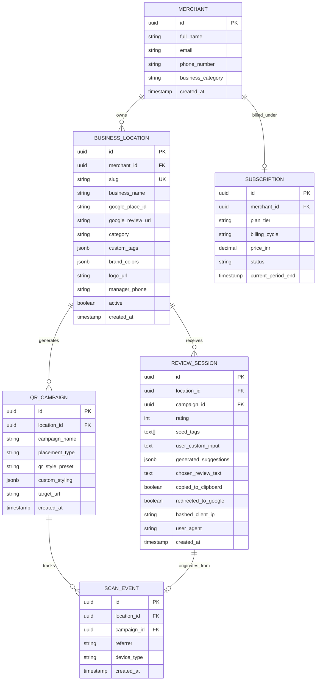

# Document 1: Domain & Data Model — ReviewPulse AI (QR Review SaaS)

## 1. Executive Summary
**ReviewPulse AI** is a multi-tenant QR-based reputation acceleration SaaS engineered for Indian local businesses (restaurants, salons, dental clinics, retail outlets, auto workshops, and hotels). The platform enables merchants to capture authentic Google Business Profile (GBP) reviews at physical points of interaction (bill counters, dining tables, waiting lounges) using mobile-optimized single-screen experiences paired with Gemini 2.5 Flash review generation.

---

## 2. Core Domain Entities & ER Model

---

## 3. Entity Specifications & Field Constraints

### 3.1. `Merchant` (Tenant Owner)
| Field | Type | Constraints | Description |
| :--- | :--- | :--- | :--- |
| `id` | UUID | Primary Key, `gen_random_uuid()` | Unique merchant identifier |
| `full_name` | VARCHAR(120) | NOT NULL, min 2 chars | Shopkeeper or business owner name |
| `email` | VARCHAR(255) | NOT NULL, UNIQUE, valid email | Contact & notification email |
| `phone_number` | VARCHAR(15) | NOT NULL, E.164 (`+91...`) | Indian mobile number for WhatsApp alerts & OTP |
| `demo_mode` | BOOLEAN | DEFAULT TRUE | Allows immediate evaluation before live billing |
| `created_at` | TIMESTAMPTZ | DEFAULT `NOW()` | Audit creation timestamp |

### 3.2. `BusinessLocation` (Target Listing)
| Field | Type | Constraints | Description |
| :--- | :--- | :--- | :--- |
| `id` | UUID | Primary Key | Location entity UUID |
| `merchant_id` | UUID | FK -> `Merchant.id` ON DELETE CASCADE | Tenant reference |
| `slug` | VARCHAR(80) | NOT NULL, UNIQUE, lowercase alphanumeric | Unique URL path `/r/[slug]` scanned by customer |
| `business_name` | VARCHAR(150) | NOT NULL | Registered name of the business |
| `google_place_id` | VARCHAR(100) | NULLABLE | Google Place ID (e.g., `ChIJN1t_tDeuEmsRUsoyG83frY4`) |
| `google_review_url` | TEXT | NOT NULL | Direct write URL `https://search.google.com/local/writereview?placeid=...` |
| `category` | VARCHAR(50) | NOT NULL | `restaurant`, `salon`, `dental`, `retail`, `cafe`, `hotel`, `service` |
| `default_tags` | JSONB | NOT NULL | Array of 6-8 default keyword chips (e.g., `["Quick Service", "Friendly Staff"]`) |
| `brand_theme` | JSONB | NOT NULL | Primary color hex, accent hex, cover photo, logo URL |
| `manager_phone` | VARCHAR(15) | NULLABLE | Direct WhatsApp number for private escalations (<4 stars) |
| `active` | BOOLEAN | DEFAULT TRUE | Kill switch for location QR routing |

### 3.3. `QRCampaign` (Physical Placement Channel)
| Field | Type | Constraints | Description |
| :--- | :--- | :--- | :--- |
| `id` | UUID | Primary Key | Campaign UUID |
| `location_id` | UUID | FK -> `BusinessLocation.id` | Target location |
| `campaign_name` | VARCHAR(100) | NOT NULL | e.g. "Main Cash Counter Stand", "Table 4 Tent", "Takeaway Bill" |
| `placement_type` | ENUM | `counter_stand_4x6`, `table_tent_a6`, `bill_sticker_square`, `raw_qr` | Physical design template |
| `qr_foreground` | VARCHAR(7) | DEFAULT `#0f172a` | QR module hex color |
| `qr_background` | VARCHAR(7) | DEFAULT `#ffffff` | QR background hex color |
| `include_logo` | BOOLEAN | DEFAULT TRUE | Center badge logo toggle |

### 3.4. `ReviewSession` (Ephemeral Conversion Funnel)
| Field | Type | Constraints | Description |
| :--- | :--- | :--- | :--- |
| `id` | UUID | Primary Key | Unique session UUID |
| `location_id` | UUID | FK -> `BusinessLocation.id` | Associated business location |
| `campaign_id` | UUID | FK -> `QRCampaign.id` (Nullable) | Scan source attribution |
| `rating` | SMALLINT | 1 to 5, NOT NULL | Customer rating given on landing page |
| `seed_tags` | TEXT[] | DEFAULT ARRAY[] | Selected vibe/service chips |
| `user_notes` | TEXT | NULLABLE, max 250 chars | Optional customer custom one-liner |
| `generated_options`| JSONB | NOT NULL | 3 Gemini suggestions: `{ short: "...", descriptive: "...", hinglish: "..." }` |
| `chosen_text` | TEXT | NULLABLE | Final text copied by user |
| `action_taken` | ENUM | `copied_and_opened_google`, `direct_opened_google`, `contacted_manager`, `abandoned` | Terminal event |
| `ip_hash` | VARCHAR(64) | NOT NULL | Salted SHA-256 hash of client IP (anonymized for spam protection) |
| `created_at` | TIMESTAMPTZ | DEFAULT `NOW()` | Timestamp |

---

## 4. Business Invariants & Validation Rules
1. **Google Review Link Validation**: The `google_review_url` must match valid Google review formats (`search.google.com/local/writereview?placeid=...` or `g.page/r/.../review`).
2. **Slug Immutability & Clean Routing**: Merchant slugs must be URL-safe (`[a-z0-9-]`), lowercase, with a minimum length of 3 and maximum of 60 characters.
3. **No PII Collection from End Customers**: The review landing page collects **zero PII** (no customer name, email, or phone required to scan and review). This minimizes friction and guarantees total compliance with Indian Digital Personal Data Protection (DPDP) Act.
4. **Anti-Gating Ethical Compliance**: All star ratings (1 to 5) retain an active, visible, non-blocked button to proceed to Google Reviews. For ratings 1-3, an auxiliary *"Talk to the Owner / Manager directly"* button is presented as an empathetic alternative, never as a gate.

