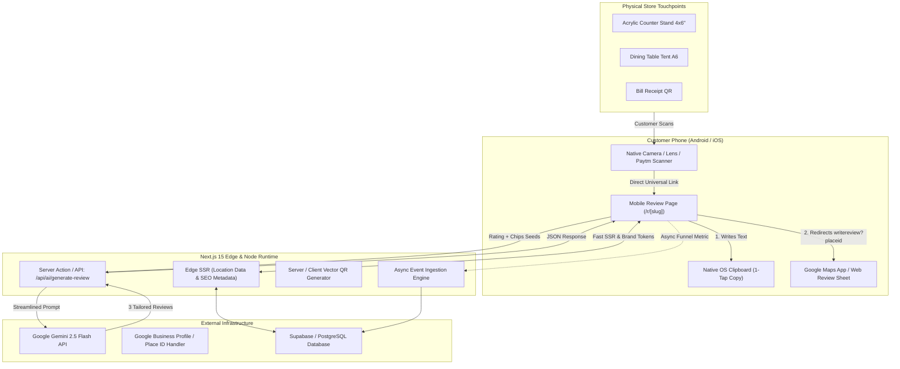

# Document 3: Architecture & Module Seams — ReviewPulse AI

## 1. System Topology & Request Flow

ReviewPulse AI is designed around a zero-latency, mobile-first edge architecture. The platform operates as two interconnected domains within a single Next.js 15 App Router codebase:
1. **Public Review Consumer Portal (`/r/[slug]`)**: High-speed, lightweight SSR/PWA-ready landing card for phone scanners.
2. **Merchant Operations Dashboard (`/dashboard`)**: Full-featured admin workspace for QR studio customization, Place ID configuration, and conversion analytics.



---

## 2. Module Seams & Boundaries

### 2.1. Module A: Customer Review Portal (`/r/[slug]`)
* **Responsibility**: Deliver an instant (<1.2s LCP) interactive card where the customer selects stars, taps 2 tags, previews AI generated text, copies to clipboard, and deep-links directly into Google's official review box.
* **Seam Boundary**:
  - Receives serialized `BusinessProfileDTO` from Next.js server component.
  - Zero authenticated session required.
  - No client-side Gemini API key exposure; communicates exclusively with `/api/ai/generate-review`.
  - Exposes zero PII to backend.

### 2.2. Module B: Gemini Review Generation Engine (`/api/ai/generate-review`)
* **Responsibility**: Receive star rating, category, and seed keywords; synthesize 3 varied, authentic, first-person reviews within 800ms.
* **Input Contract**:
  ```typescript
  interface GenerateReviewRequest {
    locationId: string;
    rating: number; // 1 to 5
    selectedTags: string[]; // e.g. ["Quick Service", "Paneer Tikka"]
    customNotes?: string; // Optional user one-liner
    languagePreference?: "en" | "hinglish";
  }
  ```
* **Output Contract**:
  ```typescript
  interface GenerateReviewResponse {
    options: [
      { id: "opt_short"; label: "Short & Punchy"; text: string },
      { id: "opt_detailed"; label: "Detailed Experience"; text: string },
      { id: "opt_conversational"; label: "Friendly / Hinglish"; text: string }
    ];
    latencyMs: number;
  }
  ```
* **Security Guardrails**:
  - Rate limiting per IP: Max 10 calls per minute (prevents automated quota drain).
  - Strict system prompt escaping to prevent prompt injection or offensive text generation.

### 2.3. Module C: QR Print Studio Engine (`/dashboard/qr-studio`)
* **Responsibility**: Dynamically generate high-DPI vector SVG and PDF printable assets for physical merchant merchandising.
* **Supported Layout Presets**:
  1. **Acrylic Counter Stand (4" x 6")**: Clean portrait layout with merchant logo, scan instructions, 5-star Google logo badge, and high-contrast QR.
  2. **Table Tent (A6 Foldable)**: Dual-sided printable tent with warm call-to-action ("Loved our food? Leave us a review in 30 seconds").
  3. **Bill / Receipt Sticker (2" x 2")**: Compact high-density sticker for placement on takeaway boxes or paper bills.
* **Seam Boundary**: Generates standalone vector SVG client-side or server-side without external cloud rasterization dependencies.

### 2.4. Module D: Merchant Dashboard & Configuration (`/dashboard`)
* **Responsibility**: Manage business locations, resolve Google Place ID automatically via place search or direct link input, configure category tags, and view conversion funnels.
* **Conversion Funnel Metrics**:
  - `Total Scans` $\rightarrow$ `Rating Taps` $\rightarrow$ `AI Generations` $\rightarrow$ `Google Handoffs` (Conversion Rate %).
  - Average satisfaction rating distribution (1 to 5 stars).

---

## 3. Google Handoff & Anti-Gating Architecture
To maintain 100% compliance with Google's Terms of Service and global consumer protection standards:
1. **Unconditional Route to Google**:
   Regardless of whether the user taps 1, 2, 3, 4, or 5 stars, the primary action button to **"Post directly on Google"** is **always present and functional**.
2. **Empathetic Remediation for Sub-4 Ratings**:
   If a user taps 1, 2, or 3 stars, an additional contextual card surfaces smoothly:
   - *"We are truly sorry your experience wasn't 5-star. Would you like to share this directly with the owner on WhatsApp so we can make it right immediately?"*
   - Two equal options are provided:
     1. `[Message Owner on WhatsApp]` (Direct escalation to `manager_phone`).
     2. `[Continue to Google Reviews]` (Direct launch of official Google review dialog).
   - This prevents review gating penalties while giving local shopkeepers an immediate opportunity to resolve unhappy customer issues.

