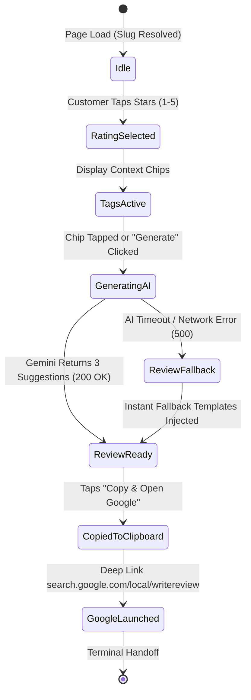

# Document 5: API & State Transitions — ReviewPulse AI

## 1. Customer Review Funnel State Machine

The customer mobile review page (`/r/[slug]`) operates on a finite state machine ensuring atomic, predictable transitions:



### State Definitions & Guards:
- **`Idle`**: Default state on load. 5 empty amber outline stars. Default tags disabled until rating is selected.
- **`RatingSelected`**: Stars light up with spring bounce. If rating is 4 or 5, auto-selects top 2 positive chips and triggers initial AI generation. If rating is 1, 2, or 3, triggers constructive feedback prompt and displays the private owner WhatsApp option alongside the Google link.
- **`GeneratingAI`**: Shimmer skeleton placeholder over suggestion cards. AbortController cancels pending request if customer taps a different star rating.
- **`ReviewReady`**: 3 distinct cards populated. First option selected by default. Customer can tap any option to switch or edit directly.
- **`CopiedToClipboard`**: Executes `navigator.clipboard.writeText(selectedText)`. Shows 1.5s visual confirmation ("✓ Copied to clipboard!").
- **`GoogleLaunched`**: Triggers `window.open(business.google_review_url, '_blank')` or direct location change.

---

## 2. API Endpoints & Request/Response Contracts

### 2.1. `POST /api/ai/generate-review`
Invokes Google Gemini 2.5 Flash with strict formatting and latency constraints.

* **Request Payload**:
  ```json
  {
    "slug": "the-spice-symphony-lucknow",
    "businessName": "The Spice Symphony",
    "category": "Restaurant",
    "rating": 5,
    "selectedTags": ["Crispy Paneer Tikka", "Fast Service", "Polite Staff"],
    "userNotes": "Great music on Friday night"
  }
  ```

* **Server-Side Gemini System Prompt**:
  ```text
  You are an expert review writing assistant for local Indian businesses.
  Generate 3 short, realistic, first-person Google customer reviews based on the user's rating, business type, and selected highlights.
  Rules:
  1. Tone must be natural, genuine, and authentic (avoid robotic corporate buzzwords like 'culinary paradise', 'exquisite gastronomy').
  2. Variation 1 (short): Punchy 1-2 sentences.
  3. Variation 2 (detailed): 2-3 sentences mentioning specific highlights and service.
  4. Variation 3 (hinglish/conversational): Friendly conversational review popular in Indian metropolitan dining and retail.
  5. Output strictly valid JSON matching the schema without markdown codeblocks.
  ```

* **Response Payload (HTTP 200)**:
  ```json
  {
    "success": true,
    "latencyMs": 680,
    "suggestions": [
      {
        "id": "short",
        "label": "Short & Punchy",
        "text": "Had a great time at The Spice Symphony! The Crispy Paneer Tikka was delicious and service was super fast."
      },
      {
        "id": "detailed",
        "label": "Detailed Experience",
        "text": "Visited The Spice Symphony for dinner. Really impressed by the polite staff and quick service. The Paneer Tikka was fresh and crispy, and the Friday night music added a great vibe. Highly recommended!"
      },
      {
        "id": "conversational",
        "label": "Casual & Friendly",
        "text": "Super polite staff and amazing food. Loved the Crispy Paneer Tikka and quick service. Definitely coming back with family!"
      }
    ]
  }
  ```

* **Graceful Degradation / Fallback**:
  If Gemini API fails, times out (>2000ms), or reaches rate limits, the server returns pre-computed algorithmic templates matching the category and tags without breaking the customer UI.

---

### 2.2. `POST /api/analytics/track`
Lightweight, beacon-compatible tracking endpoint for merchant funnel analysis.

* **Request Payload**:
  ```json
  {
    "locationId": "loc_e49b817c",
    "campaignId": "camp_counter_stand",
    "eventType": "scan" | "rating_select" | "ai_generate" | "copy_google_click" | "whatsapp_manager_click",
    "metadata": {
      "rating": 5,
      "tagCount": 3
    }
  }
  ```

* **Response Payload (HTTP 200)**:
  ```json
  {
    "acknowledged": true
  }
  ```

---

### 2.3. `GET /api/business/resolve-place`
Helper endpoint for merchants in the dashboard to look up their Google Place ID and test the direct review URL.

* **Query Parameters**: `?query=Spice+Symphony+Gomti+Nagar` or `?url=https://maps.app.goo.gl/...`
* **Response Payload**:
  ```json
  {
    "placeId": "ChIJbXkLw7Wn5DsR9o9eY2k9_x4",
    "businessName": "The Spice Symphony",
    "formattedAddress": "Vipin Khand, Gomti Nagar, Lucknow, Uttar Pradesh",
    "generatedReviewUrl": "https://search.google.com/local/writereview?placeid=ChIJbXkLw7Wn5DsR9o9eY2k9_x4",
    "currentRating": 4.8,
    "totalReviews": 842
  }
  ```

