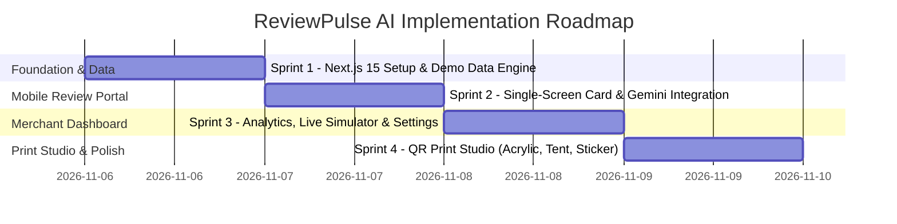

# Document 7: Implementation Sprint Plan & Quality Gates — ReviewPulse AI

## 1. Sprint Roadmap & Execution Phases

### Sprint 1: Next.js 15 Foundation & Domain Seams
- Initialize Next.js 15 App Router codebase with Tailwind CSS, Lucide-React, and Framer Motion.
- Establish the mock demo database layer with 3 realistic Indian business profiles:
  1. **The Spice Symphony** (Fine dining restaurant, Gomti Nagar, Lucknow)
  2. **Dr. Neha's Dental Care** (Dental clinic, Indiranagar, Bengaluru)
  3. **Urban Glow Unisex Salon** (Luxury salon & spa, Bandra, Mumbai)
- Provide instant one-click switching between demo business profiles to test different industries without manual data entry.

### Sprint 2: Mobile Review Single-Screen Experience (`/r/[slug]`)
- Build the **Single-Screen Compact Card** adhering strictly to the thumb-horizon (no scrolling needed on standard 360–430px screens).
- Implement interactive 5-star selector with Framer Motion spring physics.
- Implement category-specific quick-chips (Food, Service, Vibe, Ambiance, Hygiene).
- Implement server-side Gemini 2.5 Flash review generator (`/api/ai/generate-review`) with graceful fallback to category heuristics.
- Implement 1-Tap **"Copy Review & Open Google Maps"** with clipboard API integration and tactile visual confirmation toast.
- Implement compliant sub-4 star empathetic escalation (WhatsApp message to manager option alongside direct Google link).

### Sprint 3: Merchant Dashboard & Conversion Analytics (`/dashboard`)
- High-level KPI metrics grid:
  - Total Scans
  - Star Ratings Given
  - AI Reviews Generated
  - Google Handoffs & Conversion Rate (%)
- Interactive **Live Mobile Simulator**: See exactly how the customer card looks and behaves in real-time as merchant edits brand colors, tags, and logo.
- Location Profile Editor: Google Place ID configuration with automated link validator.

### Sprint 4: Built-in QR Print Studio (`/dashboard/qr-studio`)
- Dynamic Vector QR Generator with custom brand logo embed and color styling.
- Three production-ready print templates:
  1. **Acrylic Counter Stand (4" x 6")**
  2. **Foldable Table Tent (A6)**
  3. **Bill / Packaging Sticker (2" x 2")**
- Instant browser print preview and high-resolution SVG/PDF export.
- Tablet and desktop responsive adaptations across all views.

---

## 2. Quality Gates & Acceptance Criteria

| Gate | Target Metric | Verification Method |
| :--- | :--- | :--- |
| **QG-1: Mobile Performance** | First Contentful Paint < 1.0s, LCP < 1.2s | Chrome DevTools Lighthouse audit on simulated 4G mobile |
| **QG-2: Zero-Scroll Mobile Viewport** | 100% of interactive review card visible in ≤ 660px viewport | Visual regression test on iPhone SE (375x667) & Android (390x844) |
| **QG-3: Google TOS Anti-Gating** | 100% of 1–5 star paths permit reaching Google review URL | Functional automated & manual test of 1-star through 5-star clicks |
| **QG-4: AI Latency & Resilience** | Review suggestions return in < 1000ms; zero UI crashes on API timeout | Chaos testing with simulated Gemini network cutoff |
| **QG-5: Component Line Budget** | No single component file exceeds 300 lines | Static AST / line count inspection |
| **QG-6: Touch Target Ergonomics** | All buttons, stars, and chips maintain minimum 48px hit area | Mobile touch inspector audit |

